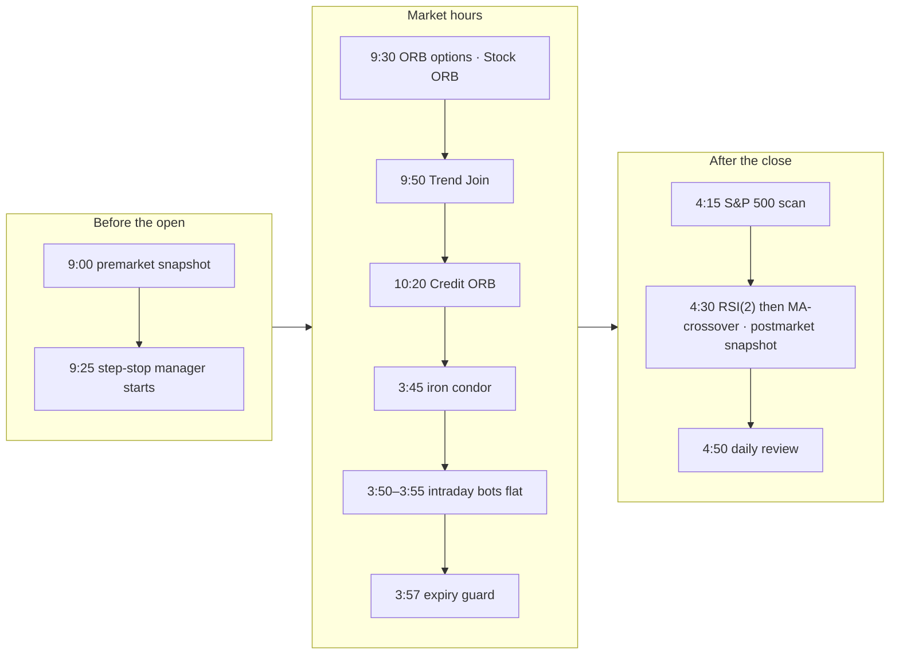
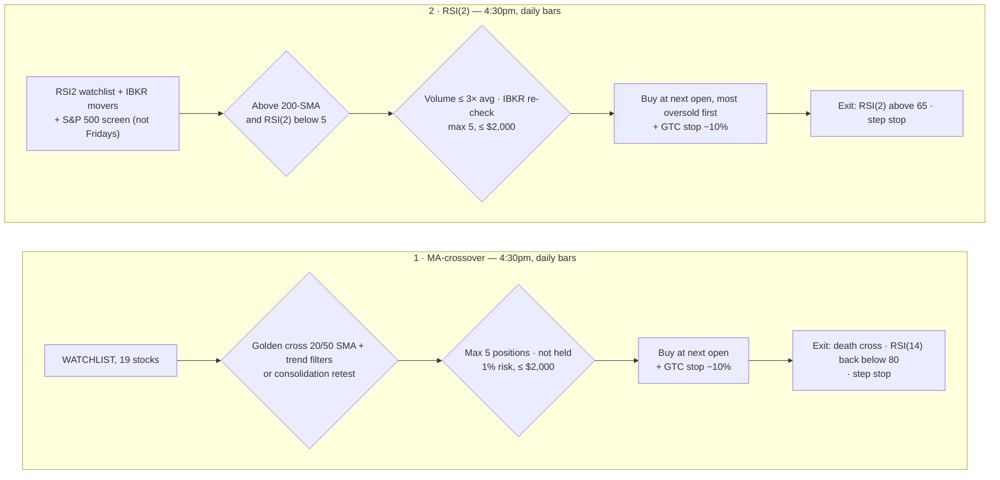
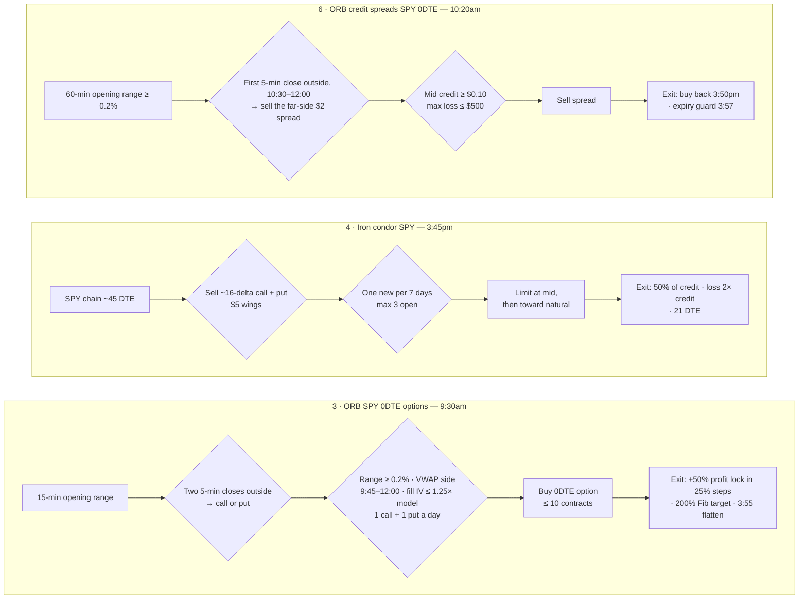
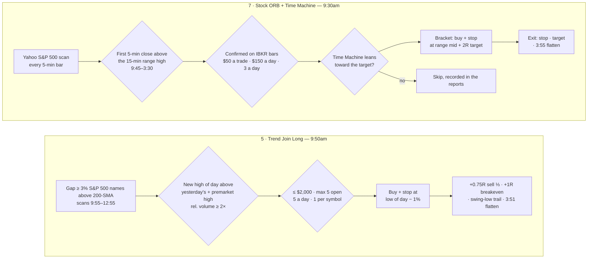

# trading-bot

Automated trading bots for Interactive Brokers (via `ib_async`): six
independent strategies covering stocks and SPY options, plus daily,
weekly and monthly P&L reports. **Paper trading only (account `DU…`) until
you explicitly opt into live money.**

## Strategies at a glance

| # | Strategy | Instrument | Style | Schedule (ET, Mon–Fri) | Entrypoint |
|---|---|---|---|---|---|
| 1 | MA-crossover + consolidation retest | Stocks — `WATCHLIST` (19 names) | Trend-following, daily bars, swing (days–weeks) | 4:30pm, right after RSI(2) — `RSI2TradingBot` | `run_ibkr_bot` |
| 2 | RSI(2) mean-reversion | Stocks — `RSI2_WATCHLIST` (10) + IBKR top movers + S&P 500 yfinance screen (scans not on Fridays) | Dip-buying, daily bars, swing (days) | 4:30pm — `RSI2TradingBot` | `run_rsi2_bot` |
| 3 | Opening Range Breakout (ORB) | SPY 0DTE calls/puts | Intraday options | 9:30am–4:00pm — `ORBTradingBot` | `run_orb_bot` |
| 4 | Iron condor | SPY options, ~45 DTE | Premium selling, multi-week | 3:45pm — `IronCondorTradingBot` | `run_iron_condor_bot` |
| 5 | Trend Join Long | S&P 500 gap-up stocks | Intraday gap-and-go | 9:50am–4:00pm — `TrendJoinTradingBot` | `run_trend_join_bot` |
| 6 | ORB credit spreads *(paper experiment)* | SPY 0DTE put/call credit spreads | Sells premium on the far side of the range | 10:20am–4:00pm — `CreditOrbTradingBot` | `run_credit_orb_bot` |
| 7 | Stock ORB *(paper experiment)* | S&P 500 stocks | Intraday opening-range breakout ([day-trader-skill](https://github.com/Jakeschincariol/day-trader-skill) rules), traded only when its Time Machine agrees | 9:30am–4:00pm — `StockOrbTradingBot` | `run_stock_orb_bot` |
| — | Step-stop manager (not a strategy) | MA-crossover + RSI(2) positions | Raises stops in 10% profit steps | 9:25am–4:00pm — `StepStopTradingBot` | `run_step_stop_bot` |

Run any of them manually with `python -m tradingbot.<entrypoint>`.

### Daily schedule (ET, Mon–Fri — Windows Task Scheduler)

| Time | Task | What happens |
|---|---|---|
| 9:00am | `SnapshotPremarketBot` | Premarket report |
| 9:25am → 4:00pm | `StepStopTradingBot` | Stop audit, then raises stock stops every ~60s |
| 9:30am → 4:00pm | `ORBTradingBot` | SPY opening-range breakout (filtered), step-up lock; entries 9:45–12:00, flat by 3:55pm |
| 9:30am → 4:00pm | `StockOrbTradingBot` | S&P 500 opening-range breakouts; Time Machine check before each entry (trades only if it leans toward the target); entries 9:45–3:30 (max 3), stop/target at IBKR, flat by 3:55pm |
| 9:50am → 4:00pm | `TrendJoinTradingBot` | Gap scans 9:55–12:55, entries 10:05–3:30, flat by 3:51pm |
| 10:20am → 4:00pm | `CreditOrbTradingBot` | 60-min range; entry 10:30–12:00; spread bought back 3:50pm |
| 3:45pm | `IronCondorTradingBot` | Manage / open SPY iron condors |
| 3:57pm | `ExpiryGuardBot` | Safety net: closes any option expiring today still open (normally nothing) |
| 4:30pm | `RSI2TradingBot` | RSI(2), then MA-crossover (stop audit first in each) |
| 4:30pm | `SnapshotPostmarketBot` | Postmarket report (+ weekly on Fridays, monthly on the last trading day) |
| 4:15pm | `SP500ScanBot` | Saves the S&P 500 scan (movers, unusual volume, strategy buy signals) to `scans/YYYY/MM/DD/` |
| 4:50pm | `DailyReviewBot` | Daily review: facts script + Claude Code (read-only) writes recommendations to `analysis/daily/YYYY/MM/DD/` |

### Strategy workflow

Every strategy follows the same path: **scan → entry rule → checks (any
fails → no trade) → order → exits (first one hit)**. GitHub draws these
charts; the details for each are in the numbered sections below.









### Profit-locking step stop (MA-crossover, RSI(2))

Once a position is in profit, its stop moves up in 10% steps and never
comes back down. Bought 100 shares at $10 ($1,000):

| Gain reaches | Stop moves to | Locked-in value |
|---|---|---|
| (entry) | −10% ($9.00) | $900 |
| +11% ($11.10) | +10% ($11.00) | $1,100 |
| +21% ($12.10) | +20% ($12.00) | $1,200 |
| +31% … | +30% … | … |

The stop stays at −10% until the gain first reaches +11% (the 1% buffer
keeps the new stop from sitting right at the current price).

- **Stocks (MA-crossover, RSI(2)):** `run_step_stop_bot` checks every ~60s
  from 9:30am to 4:00pm (`StepStopTradingBot`, starts 9:25am) and raises
  the stop order at IBKR, so an intraday spike that fades still locks in
  its step. Uses client ID 1 (the ID that placed the stops) — don't run
  the MA/RSI(2) bots by hand while it's running.
- **ORB uses its own, wider step-up** (starts at +50%, 25% steps — see #3):
  the stocks' 10% steps were too tight for 0DTE option premiums in the
  backtest (profit factor 0.98).
- Not applied to Trend Join (its own breakeven + swing-low trail) or the
  iron condor (short premium; already closes at 50% of max profit).
- Settings: `STEP_STOP_ENABLED`, `STEP_STOP_PCT`, `STEP_STOP_BUFFER_PCT`.

### 1. MA-crossover + consolidation retest

Code: [strategy/ma_crossover.py](src/tradingbot/strategy/ma_crossover.py),
[strategy/consolidation_retest.py](src/tradingbot/strategy/consolidation_retest.py)

- **Entry A — golden cross:** 20-SMA crosses above 50-SMA, **and** price
  above 200-SMA, 5-day avg volume ≥ 20-day avg, RSI(14) < 70, price above
  the 20-day rolling VWAP.
- **Entry B — consolidation retest:** 15-day range ≤ 6% → breakout close
  above it on ≥ 1.2× volume → within 5 bars, a dip back to the breakout
  level that closes back above it.
- **Exit:** death cross (20-SMA below 50-SMA), or RSI(14) goes above 80 and
  falls back below it; plus the broker-side stop (−10%, then raised in 10%
  profit steps).

### 2. RSI(2) mean-reversion

Code: [strategy/rsi2_mean_reversion.py](src/tradingbot/strategy/rsi2_mean_reversion.py),
[run_rsi2_bot.py](src/tradingbot/run_rsi2_bot.py)

- **Entry:** price above 200-SMA **and** RSI(2) < 5. Blocked if today's
  volume is > 3× the 20-day average (news-driven move, not a technical dip).
- **Exit:** RSI(2) > 65; plus the broker-side stop (−10%, then raised in
  10% profit steps).
- **Universe:** fixed `RSI2_WATCHLIST` + IBKR top gainers/losers/most-active
  (price ≥ $10, volume ≥ 500k) + an S&P 500 screen via yfinance (all ~500
  names in one download; up to 20 RSI(2) buy hits, most oversold first).
  IBKR re-checks every candidate on its own bars before ordering. Both
  scans are skipped on Fridays to avoid weekend-gap risk. Runs after the
  close, so orders fill at the next open.
- **Entry order:** exits first, then buys lowest RSI(2) first, so limited
  slots (max 5) go to the most oversold setups.

**Sizing for #1 and #2:** 1% account risk per trade, capped at $2,000
notional per position (`MAX_POSITION_VALUE`), 10% broker-side **GTC** stop
(cancelled automatically when the bot sells), max 5 positions each.

### 3. Opening Range Breakout (SPY 0DTE options)

Code: [options/orb_strategy.py](src/tradingbot/options/orb_strategy.py),
[run_orb_bot.py](src/tradingbot/run_orb_bot.py)

- **Symbols:** `ORB_SYMBOLS` = SPY (the bot supports several, each traded
  independently). IWM was dropped 2026-09-29: no exit variant made it
  profitable over 4 years (PF 0.94-0.99). QQQ needs a Nasdaq market data
  subscription this account doesn't have.
- **Opening range:** high/low of the first 15 minutes.
- **Entry (since 2026-10-02):** a call when **two consecutive completed
  5-min bars close above the range** (a put: below), and only if:
  - the range is at least **0.2%** of the day's open;
  - the breakout bar closed on **VWAP's side** (calls above, puts below);
  - it's **before 12:00**;
  - recent fills aren't priced more than **1.25×** the VIX-calibrated
    estimate (`ORB_IV_PAUSE_RATIO`) — the edge depends on option prices.
  One call and one put per day at most; no re-entries.
- **Exits** (first one hit):
  - **Step-up profit lock:** once the option is up 50%, its stop moves to
    +25%, then follows 25% of entry behind each further 25% step —
    bought $1.00: $1.50 → stop $1.25, $1.75 → $1.50, $2.00 → $1.75.
    Never moves down; the peak is saved in the journal, so a restart
    keeps it.
  - **Fibonacci target (since 2026-10-05):** sell when SPY reaches the
    **200% extension** of the opening range (calls: range high + 1×
    range; puts: range low − 1× range) — `OPTIONS_FIB_TARGET_EXT`.
  - **3:55pm flatten**, with the 3:57pm expiry guard as backup.
  - No stop below entry and no VWAP exit: max loss = premium paid.
- **Backtest of this setup** ([scripts/orb_research_tests.py](scripts/orb_research_tests.py),
  999 SPY sessions Oct 2022–Oct 2026, option prices calibrated to real
  fills via the VIX): profit factor **1.56**, +$81k on $100k, 70% of
  trades win, max drawdown **−3.8%**. Still positive at $0.05/share
  slippage (1.34) and with options 25% pricier than estimated (1.14).
  Without the 200% target: PF 1.51, max drawdown −7.2%. Nearer Fibonacci
  targets hurt (127.2%: PF 0.95; 161.8%: 1.25); a 261.8% target in place of
  the step-up lock scored highest (PF 1.65) but gives up the profit lock
  (`--fib` in [scripts/orb_research_tests.py](scripts/orb_research_tests.py)).
- **Why these rules:** see the
  [2026-10-01 ORB loss analysis](analysis/2026-10-01_orb_loss_analysis/).
  Live 9/14–10/1 lost −$1,796; the VWAP exit caused all of it, and the
  old backtest priced 0DTE options ~1.4× too cheap. The entry filters
  come from published practitioner rules (Option Alpha, Quantish, SPXXL,
  Kay Capitals), not from searching our own data.
- **Rejected after testing:** fixed premium stops (−20%/−30%/−50%), the
  stocks' 10% step stop, a +50% target, VWAP exit, re-entry (new
  high/low or VWAP pullback), a daily loss limit, and the options.cafe
  rules (+100%/−50%/3:30pm: PF 1.11–1.16, fragile). All remain in
  settings, switched off.
- One position per symbol at a time, max 10 contracts; exits checked
  every 60s, and **every 5s once its profit lock is active** (since
  2026-10-13, when an option fell through its $0.99 lock to $0.91 between
  60s checks), using streaming quotes. Entry bars
  are fetched once per completed 5-min bar, inside IBKR's pacing limit. Open positions are recovered from the journal if the
  process restarts.

### 4. Iron condor (SPY)

Code: [options/iron_condor.py](src/tradingbot/options/iron_condor.py),
[run_iron_condor_bot.py](src/tradingbot/run_iron_condor_bot.py)

- **Entry:** sell ~16-delta call and put, buy $5-wide wings, ~45 DTE. At
  most one new condor every 7 days, max 3 open.
- **Exit (first hit):** 50% of credit captured, loss = 2× credit, or 21 DTE.
  Closing orders step from the mid toward the natural price (3 attempts,
  re-quoted); opening orders try the mid, then halfway to the natural
  credit. Strikes come from those actually listed for the expiry.
- Max 10 contracts per trade. SPY only (`CREDIT_SPREAD_SYMBOLS`). QQQ is
  blocked (no Nasdaq market data subscription). IWM option quotes were
  confirmed live on 2026-09-28, but IWM condors haven't been re-tested
  since earlier 4-leg orders failed to fill.

### 5. Trend Join Long (S&P 500 intraday gap-and-go)

Code: [strategy/trend_join.py](src/tradingbot/strategy/trend_join.py),
[run_trend_join_bot.py](src/tradingbot/run_trend_join_bot.py). Source:
[Humbled Trader — AI trading bot with Claude + IBKR](https://www.humbledtrader.com/blog/ai-trading-bot-claude-ibkr/)

- **Prefilter** (yfinance, at 9:55, 10:25 … 12:55): S&P 500 names whose
  open gapped ≥ 3% above yesterday's close **and** whose close yesterday
  was above the 200-SMA; top 20 by gap size.
- **Entry** (every completed 5-min bar, 10:05–3:30) — all must pass:
  - price above yesterday's high
  - price above today's premarket high (4:00–9:30)
  - bar closes at a new high of day
  - relative volume ≥ 2× (cumulative volume vs. the 14-day average at the
    same time of day)
- **Exit:**
  - initial stop = low of day − 1% (never more than 10% below entry),
    placed at IBKR together with the entry
  - +0.75R → sell ⅓ (R = entry − initial stop)
  - +1R → stop to breakeven
  - after breakeven → trail stop 1¢ under 5-min swing lows (2 bars each side)
  - 3:51pm → flatten everything
- **Limits:** $2,000 per position, max 5 open, max 5 trades/day, one entry
  per symbol per day. Never trades symbols on the other watchlists or
  already held.
- No backtest — the article's own backtest doesn't transfer to live
  execution; paper-trade it for at least 2 weeks before judging it.

### 6. ORB credit spreads (SPY 0DTE, paper experiment since 2026-10-02)

Code: [options/credit_orb.py](src/tradingbot/options/credit_orb.py) (rules,
shared with the backtest), [run_credit_orb_bot.py](src/tradingbot/run_credit_orb_bot.py).
Source: Option Alpha and Quantish published SPX 0DTE ORB research
(~87–89% win rate, PF 1.3–1.44) — see
[analysis/2026-10-01_orb_loss_analysis](analysis/2026-10-01_orb_loss_analysis/).

- **Opening range:** the first 60 minutes (9:30–10:30); must be at least
  0.2% of the open.
- **Entry:** the first completed 5-min close outside the range between
  10:30 and 12:00, one trade a day. Breakout up → **sell a put spread**
  with the short put at/below the range low; breakout down → **sell a
  call spread** with the short call at/above the range high. $2 wide.
- **Minimum credit:** the spread's mid credit must be at least $0.10
  (`CREDIT_ORB_MIN_CREDIT`), or the breakout is skipped for the day — the
  log says `credit 0.06 below minimum 0.10 — skipping` (as on 2026-10-14).
  Below that, the premium doesn't cover the risk of the $2 width.
- **Exit:** hold; bought back at 3:50pm (SPY options settle in shares, so
  nothing is left to expire; the 3:57pm expiry guard is the backup). If the
  long leg has no bid (worthless, common near the close), only the short
  leg is bought back and the long leg is left to expire worthless.
- **Size:** max loss (width − credit) ≤ $500 per trade
  (`CREDIT_ORB_MAX_LOSS_DOLLARS`), ≤ 10 contracts.
- **Why it's an experiment:** the idea is to earn time decay instead of
  paying it (the long-option ORB's weakness). Our Black-Scholes backtest
  can't judge it — it has no option smile, so it undercounts the premium
  of out-of-the-money puts and shows a loss
  ([scripts/credit_orb_backtest.py](scripts/credit_orb_backtest.py)). The
  bot records both legs' real bid/ask every ~5 minutes
  (`credit_orb_marks`) to build the data to judge it properly.

### 7. Stock ORB (S&P 500 intraday, paper experiment since 2026-10-27)

Code: [strategy/stock_orb.py](src/tradingbot/strategy/stock_orb.py) (rules,
shared with the backtest, and the adapter to the vendored Time Machine),
[run_stock_orb_bot.py](src/tradingbot/run_stock_orb_bot.py). Source: the
published rules of Jake Schincariol's
[day-trader-skill](https://github.com/Jakeschincariol/day-trader-skill)
pack (MIT), run as published — all values are the pack's defaults — plus
one addition of the owner's (2026-10-29): the Time Machine gate below.

Each breakout, in order: **scan → confirm on IBKR → Time Machine → trade
only if it agrees → bracket order → stop / target / 3:55 flatten.**

- **Entry:** 15-min opening range (9:30–9:45). The first 5-min bar that
  *closes* above the range high (a wick doesn't count), ending 9:45–3:30.
  Long only. Every 5-min bar the bot scans the S&P 500 on Yahoo (the pack
  scans ~5,900 stocks — too many for IBKR's or Yahoo's limits every 5
  minutes), ranks fresh breakouts by dollars traded, and re-checks each on
  IBKR's own bars before buying.
- **Exit:** stop at the range midpoint, target at 2R, both at IBKR as a
  bracket (one cancels the other); anything left is sold at 3:55pm.
- **Risk (trader-risk defaults):** $50 per trade, $150 of stop-risk a day,
  3 trades a day, $4,000 max position, one entry per symbol per day. Skips
  the MA/RSI(2) watchlists, anything already held (manual positions
  included) and Trend Join's symbols.
- **Time Machine gate:** before each entry the bot runs the pack's
  own Time Machine — vendored verbatim in
  [vendor/timemachine.py](src/tradingbot/vendor/timemachine.py) with its
  MIT license and its 47 tests — on that trade: 10,000 simulated
  rest-of-day paths built from the stock's last 60 days of 5-min bars, plus
  the same rule on every past session, up to the 3:55pm flat-by; the full
  report goes to the log. **The trade is placed only when the Time Machine
  agrees** — its verdict "Leans toward the target" or "Strongly toward the
  target" (the target's share of the replays that hit a side beats
  break-even, 1/(1+R) = 33% at 2R, by 5+ points). Coin flips, leans toward
  the stop and refusals (e.g. under 20 full sessions of data) are skipped.
  At most 10 candidates are checked per 5-min bar (one Yahoo request each).
  Every check, traded or skipped, is in the daily, weekly and monthly
  reports ("Stock ORB — Time Machine checks") and the daily review.
  `STOCK_ORB_TM_FILTER=false` turns the gate off (report-only).
- **Why it's an experiment:** our backtest of the published rules on 60 days
  of S&P 500 5-min data ([scripts/stock_orb_backtest.py](scripts/stock_orb_backtest.py))
  shows no edge — about −0.08R per trade over ~16,000 triggers, and
  −$1,044 for the 3-a-day version at these sizes. The Time Machine gate is
  not backtested; expect it to skip most breakouts (the same 60-day history
  feeds both). The owner chose to run it
  as published and judge it on real fills.

### How the strategies stay out of each other's way

- MA-crossover and RSI(2) watchlists don't overlap; RSI(2)'s scanner
  excludes the MA watchlist. Both use client ID 1, so they run one after
  the other in the same 4:30pm task (`run_rsi2_scheduled.ps1`), never at
  the same time.
- **Manual trades are never touched.** MA-crossover and RSI(2) record
  every position they open (`stock_ownership` table) and only manage
  those. Any other held stock — bought manually or by another strategy —
  is never sold by a bot, and no bot buys more of it (IBKR merges shares
  into one position). See [ownership.py](src/tradingbot/ownership.py).
- Trend Join skips both watchlists and any symbol already held, and
  records its positions in the journal (`trend_join_positions`) so RSI(2)
  never treats them as its own.
- Each long-running process has its own IBKR client ID (orders can only be
  modified by the client ID that placed them):

  | Client ID | Used by |
  |---|---|
  | 1 | MA-crossover, RSI(2) (4:30pm), step-stop manager (9:30am–4:00pm) |
  | 90 | Expiry guard (3:57pm) |
  | 93 | Stock ORB |
  | 95 | ORB credit spreads |
  | 96 | Iron condor |
  | 97 | Trend Join |
  | 98 | ORB |
  | 99 | Snapshot reports |

## Reports

`run_snapshot` writes HTML to [reports/](reports/) and commits it locally
(no push), in a year/month/day tree:

```
reports/2026/09/28/snapshot_2026-09-28_premarket.html   (daily, per day)
reports/2026/09/weekly_2026-09-25.html                  (weekly/monthly, per month)
```

- **Daily** — 9:00am premarket and 4:30pm postmarket: open orders, open
  positions with unrealized P&L (average price per share, options too),
  positions closed today (average bought and sold price per share and net
  P&L — the bought price is worked out from IBKR's realized P&L, so it
  includes the opening commission), account P&L,
  total balance, YTD P&L (vs. `ACCOUNT_STARTING_BALANCE`), and a
  **stop-loss coverage** table (each stock's owner and working stop, with
  an UNPROTECTED warning for any bot position missing one, plus a warning
  for any stop order left on a position that no longer exists). Also a
  **Fibonacci levels** table for SPY and each held stock: 20-day swing
  high/low, 38.2/50/61.8% retracements, 127.2/161.8% extensions, and where
  price sits (computed from IBKR daily bars — the API can't read chart
  drawings).
- **Weekly** — Fridays after the close (Mon–Fri).
- **Monthly** — last trading day of the month after the close.
- **P&L by strategy** (all three reports) — closed trades, wins, win % and
  realized P&L per strategy for the day / week / month, plus a total
  ([strategy_pnl.py](src/tradingbot/strategy_pnl.py)). Strategies with
  their own journal (the option strategies, Trend Join, ...) are read from
  it (option P&L before commissions); MA-crossover and RSI(2) come from
  IBKR's stock fills (after commissions), matched to the bot that bought
  them; anything else — e.g. your own manual trades — is "Manual / other".
  Closed trades only: open positions stay in the positions table.
- **Stock ORB — Time Machine checks** (all three reports) — every breakout
  the Time Machine checked before an entry: entry / stop / target, its odds
  (target first, stop first, neither), average R, the past-sessions
  history, its verdict, the decision (traded / skipped / not filled) and
  the trade's result; with a count line ("N checked, N agreed, N traded, N
  skipped") and the traded P&L.

## Daily review (4:50pm)

`DailyReviewBot` runs [scripts/run_daily_review_scheduled.ps1](scripts/run_daily_review_scheduled.ps1):

1. [run_daily_review.py](src/tradingbot/run_daily_review.py) gathers the
   day's facts (read-only): account and closed fills (avg bought/sold
   prices), realized P&L by strategy, every ORB trade with its fill price
   vs the model and a model replay of the day, the credit spread attempts
   and quote marks, Stock ORB's trades and every Time Machine check
   (traded or skipped, with its verdict),
   stock-strategy signals and orders,
   open positions/orders, and warnings/errors from every log →
   `analysis/daily/YYYY/MM/DD/facts_<date>.md`.
2. Claude Code runs headless with **read-only tools** (no writing, shell or
   web), reads the facts, the README, the last 5 reviews and the ORB loss
   analysis, and replies with a review — summary, per-strategy table,
   problems found, recommendations labelled **Fix now / Consider / Watch**,
   and what to watch tomorrow. The script saves it as
   `review_<date>.md` and commits both files locally (no push).

Nothing is changed automatically; recommendations are for you to approve.
The prompt is [scripts/daily_review_prompt.md](scripts/daily_review_prompt.md).

## Tools

- **S&P 500 scanner** (read-only, yfinance): top gainers/losers, unusual
  volume, and which names strategies #1 and #2 would buy right now.
  `python -m tradingbot.sp500_scanner [--top 20] [--save]` — `--save`
  writes the full scan to `scans/YYYY/MM/DD/sp500_scan_<date>.csv`, a
  separate tree from `reports/` (gitignored; local only). Runs daily at
  4:15pm (`SP500ScanBot`). Stocks Yahoo's batch download drops are
  re-requested up to twice (shared with Trend Join's and RSI(2)'s screens).
- **IBKR top movers check** (read-only): `python -m scripts.check_top_movers`
- **Backtests:** `scripts/backtest_report.py`, `rsi2_backtest_report.py`,
  `options_backtest_report.py`, `iron_condor_backtest_report.py`,
  `stock_orb_backtest.py` (Stock ORB on 60 days of S&P 500 5-min bars)
- **Time Machine** (any planned day trade, by hand; never places an order):
  `python -m tradingbot.vendor.timemachine run --symbol TSLA --date 2026-10-19
  --entry 364.18 --stop 358.32 --target 370.04 --entry-time "10:15 AM" --until 15:55`
  — add `chart` instead of `run` for an ASCII fan chart. See
  [vendor/README.md](src/tradingbot/vendor/README.md).
- **ORB exit comparison:** `python scripts/orb_exit_comparison.py --symbol SPY
  [--slippage 0.05]` — six exit-rule variants on 4 years of cached 5-min
  bars, with costs and a half-year breakdown.

## Setup

### 1. Python environment

Requires Python 3.11+. From `trading-bot/`:

```
python -m venv .venv
.venv\Scripts\activate
pip install -e ".[dev]"
```

### 2. Configure

```
copy .env.example .env
```

Edit `.env`: confirm `IBKR_PORT` matches your TWS/Gateway paper port (7497
for TWS paper, 4002 for Gateway paper). Every strategy parameter above is
configurable there — see `.env.example` for the full list. Never commit
`.env` — it's gitignored.

### 3. IBKR paper account

1. Log into a paper trading account in TWS or IB Gateway.
2. Enable API access: File → Global Configuration → API → Settings →
   check "Enable ActiveX and Socket Clients", confirm the port matches
   `.env`, and add `127.0.0.1` to trusted IPs.
3. Leave TWS/Gateway running whenever the bots run — they connect locally.
4. Market data: the live account subscribes to NYSE (Network A/CTA) and
   NASDAQ (Network C/UTP) level 1 for the API (non-professional; Network B
   and options were already there), shared with the paper account
   (Settings → Paper Trading Account). Without them IBKR's intraday bars for
   NYSE/Nasdaq stocks arrive ~15 minutes late (`Error 10089`). Don't stay
   logged into the live account (TWS, IBKR Desktop, mobile app) during market
   hours: the shared data then goes to that session and the paper bots get
   `Error 10197 No market data during competing live session`.

### 4. Scheduling

Each scheduled bot has a wrapper in [scripts/](scripts/)
(`run_*_scheduled.ps1`) registered in Windows Task Scheduler; logs go to
`logs/<bot>_<date>.log`.

## Safety

- Every bot refuses to trade on an account whose ID doesn't start with
  `DU` (IBKR paper) unless `LIVE_TRADING=true` is set in `.env`.
- Every signal, order, and position is logged to `data/journal.db` (SQLite).
- Hard caps: $2,000 per stock position, 10 contracts per options trade.
- Bots never manage, sell or add to manual positions (see ownership above).
- **Stop audit:** every MA/RSI(2) run first checks that each position it
  owns has a working stop covering the full quantity. Missing → a GTC
  stop is placed at 10% below cost; already below that level → sold. Each
  snapshot also has a "Stop-loss coverage" table that flags any bot
  position as UNPROTECTED. See [protection.py](src/tradingbot/protection.py).
- **No stops on flat positions:** a stop left behind after its shares are
  sold would open a short if triggered. The stop audit skips any stock
  with an exit order already working, and leftover stops are cancelled
  automatically (every step-stop tick and every MA/RSI(2) run). Stops on
  new entries still waiting for the open are left alone.
- **No unintended shorts:** the only negative positions should be the
  iron condor's and ORB credit spreads' sold legs (a credit spread is
  recorded as pending *before* its order is sent, so its short leg is
  never mistaken for a stray). No bot trades a contract another bot
  already holds (IBKR nets positions per contract). Every sell is capped at the quantity IBKR shows
  as held; a partly-filled close books the filled part and retries only
  the remainder (at the bid); the ORB bot buys back any short option on
  its symbols every tick; the snapshot flags any other short in red. See
  [position_guard.py](src/tradingbot/position_guard.py). (2026-09-28: a
  partial-fill retry oversold, leaving short 11 IWM and 2 SPY puts.)
- **Expiry guard (3:57pm):** ORB options have no broker-side stop — the
  bot checks its VWAP exit every ~60s and flattens at 3:55pm. If the bot
  were down at the close, an in-the-money SPY/IWM option would be
  auto-exercised into shares (10 IWM contracts = 1,000 shares, ~$280k).
  `run_expiry_guard` closes any option expiring today, from any strategy,
  at market; it waits out any exit already in progress so it can't
  double-sell. See [run_expiry_guard.py](src/tradingbot/run_expiry_guard.py).
- A daily-loss kill-switch (`MAX_DAILY_LOSS_PCT`) halts new stock entries
  once tripped.

Run tests with `pytest`.

## Repositories

Both private: `rshukla29/trading-bot` (origin — all commits, including
the automatic daily report commits when pushed) and
`rshukla29/trading-bot-first` (copy — updated only on request).
